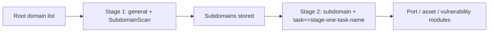

---

## name: scopesentry-mcp
description: Manage the security scanning platform (projects, tasks, templates, assets, and nodes) through ScopeSentry MCP. Use when the user mentions ScopeSentry, MCP, API keys, scan tasks, or asset queries.

# ScopeSentry MCP Guide

For users with an **existing ScopeSentry deployment**. Connect to the platform through Cursor (or another MCP client); no local source checkout is needed.

## 1. Getting Started

### 1.1 Confirm the Service Is Accessible

- Default web interface: `http://<host>`
- MCP endpoint: `http://<host>/mcp` (if a reverse proxy or frontend proxy is in use, use its actual `/mcp` URL)

### 1.2 Create an API Key

1. Sign in to the ScopeSentry web interface in a browser.
2. Open the **API Key** management page and create a key (or use an endpoint provided by an administrator).
3. Save the returned `ssk_...` string (**it is shown only once**).

### 1.3 Configure Cursor MCP

Cursor -> Settings -> MCP -> Add server:

```json
{
  "mcpServers": {
    "scopesentry": {
      "url": "http://<your-host>:8082/mcp",
      "headers": {
        "X-API-Key": "ssk_your-key"
      }
    }
  }
}
```

Alternatively, use `Authorization: Bearer ssk_your-key`.

After configuring it, restart MCP or reload Cursor. Confirm that tools such as `list_projects` and `list_assets` appear in the tool list.

---

## 2. Available Tools


| Tool                     | Purpose                |
| ---------------------- | ----------------- |
| `list_projects`        | Project tree grouped by tag (includes project IDs) |
| `list_projects_data`   | Paginated project list with name search |
| `get_project`          | Project details |
| `create_project`       | Create a project |
| `list_tasks`           | Scan task list |
| `get_task`             | Task details |
| `list_scan_templates`  | Scan template list |
| `get_scan_template`    | Template details |
| `list_plugin_modules`  | Scan pipeline module names |
| `list_plugins`         | Available plugins (including hashes and default parameters) |
| `create_scan_template` | Create a scan template |
| `create_scan_task`     | Create a scan task |
| `list_assets`          | Query asset types (paginated list) |
| `count_assets`         | Count assets (`/api/assets/common/total`) |
| `get_asset_detail`     | Asset or vulnerability details |
| `add_asset_tag`        | Add a tag to an asset |
| `list_nodes`           | Scan node list |


Use each MCP tool's description (schema) as the source of truth for its parameters. `list_assets` and `count_assets` use the same `search` and `filter` syntax; read the `list_assets` description before querying assets.

Use `count_assets` to get the total number of results (the same total as the web pagination API) instead of paging through `list_assets` repeatedly.

---

## 3. Common Workflows

### 3.1 Query Assets by Project

When the user or context **specifies a project**, include `filter.project` to narrow the query and avoid slow responses caused by data from many projects. A project filter is optional when no project is specified.

1. Use `list_projects` or `list_projects_data` to get the target project's **ObjectID** (`id` / `children[].value`).
2. Pass it to `list_assets` as `filter.project` (**it must be an ID, not the project's display name**).

```json
{
  "asset_type": "asset",
  "pageIndex": 1,
  "pageSize": 20,
  "search": "domain=^example.com",
  "filter": {
    "project": ["<projectObjectID>"]
  }
}
```

### 3.2 Create a Scan Task

1. Use `list_nodes` to get the names of online nodes.
2. Use `list_scan_templates` or `create_scan_template` to get the template **ObjectID**.
3. Call `create_scan_task`: `name` and `node` are required; set `template` to the template ID (not its name).

**Target source `targetSource` (same as in the web interface):**

| targetSource | Description | Required parameters |
| --- | --- | --- |
| `general` | Enter targets directly | `target` |
| `project` | Read targets from a project | `project` (array of project ObjectIDs) |
| `asset` | Search the web asset inventory | `search`; optional `project`, `filter`, `targetNumber` |
| `RootDomain` | Search the root domain inventory | `search`; optional `project`, `filter`, `targetNumber` |
| `subdomain` | Search the subdomain inventory | `search`; optional `project`, `filter`, `targetNumber` |
| `UrlScan` | Search URL scan results | `search`; optional `project`, `filter`, `targetNumber` |
| `*Source` (e.g., `subdomainSource`) | Create from selected or searched items on an asset page | Use `search` when `targetTp=search`; use `targetIds` when `targetTp=select` |

**Example - scan root domains directly:**

```json
{
  "name": "example-subdomain-collection",
  "node": ["node-1"],
  "template": "<templateObjectID>",
  "targetSource": "general",
  "target": "example.com\nfoo.com",
  "project": ["<projectObjectID>"]
}
```

**Example - continue scanning from the subdomain inventory (filtered by the previous task name):**

```json
{
  "name": "example-ports-and-vulnerabilities",
  "node": ["node-1"],
  "template": "<followupModuleTemplateObjectID>",
  "targetSource": "subdomain",
  "search": "task==\"example-subdomain-collection\"",
  "project": ["<projectObjectID>"]
}
```

### 3.3 Collect Complete Root Domain Information (Two Stages Recommended)

When the input is **root domains** and the goal is **complete information gathering**, run two scans instead of the entire pipeline in one scan.

**Why:** Distributed tasks are assigned per **individual target**. If a node receives a root domain as a target, the subdomains it discovers also run subsequent modules on that same node. This can cause uneven load, slower scans, and more errors.

**Recommended approach:**

1. **Stage 1 - Subdomain collection only**
   - `targetSource`: `general`
   - `target`: all root domains (one per line)
   - Template: enable only `SubdomainScan` and `SubdomainSecurity` (subdomain scanning and takeover checks).
   - Use `get_task` to wait for the task to finish.

2. **Stage 2 - Subsequent modules**
   - `targetSource`: `subdomain`
   - `search`: `task=="<stage-one-task-name>"` (exact task-name match)
   - Optionally add `project` to narrow the scope.
   - Template: port scanning, asset mapping, vulnerability scanning, and similar modules (it may omit `SubdomainScan`).
   - Distribute subdomains as independent targets across nodes for better parallel performance.

Alternatively, filter the "Subdomains" asset page by task name in the web interface, then use "Create Task from Subdomains" for the same result.



### 3.4 Create a Scan Template

1. `list_plugin_modules` -> list of module names
2. `list_plugins` (optionally filter by `module`) -> each plugin's `hash` and default `parameter`
3. `create_scan_template`: use `modules` to specify "module -> array of plugin hashes".

---

## 4. Asset Queries (`list_assets` / `count_assets`)

`count_assets` uses the same `asset_type`, `search`, and `filter` as `list_assets`. It returns `{ "total": N }`, matching the web endpoint `/api/assets/common/total`.

```json
{
  "asset_type": "subdomain",
  "search": "task==\"some-task-name\"",
  "filter": {"project": ["<projectObjectID>"]}
}
```

**Performance guidance (for `list_assets` and `count_assets`):** When a project is known, use `filter.project` to narrow the scope. For indexed fields in `search`, prefer exact `==` matches or `^` prefix matches (see [4.3](#43-search-expressions)). Broad fuzzy `=` searches can slow responses. A project filter is optional when no project context is available.

See the table in [4.4](#44-filter-exact-filtering) for asset types that support `filter.project`.

### 4.1 Asset Types (`asset_type`)

`asset`, `RootDomain`, `subdomain`, `app`, `mp`, `UrlScan`, `SensitiveResult`, `DirScanResult`, `crawler`, `vulnerability`, `PageMonitoring`, `IPAsset`, `SubdomainTakerResult`

Alias examples: `web` -> asset, `vuln` -> vulnerability, `ip` -> IPAsset, `url` -> UrlScan

### 4.2 Parameters


| Parameter                       | Description                                      |
| ------------------------ | --------------------------------------- |
| `pageIndex` / `pageSize` | Pagination; defaults to 1 / 20 |
| `search`                 | Search expression (see below) |
| `filter`                 | Exact-match JSON filter (see below) |
| `sort`                   | Only UrlScan and DirScanResult support sorting by `length` |
| `sid`                    | SensitiveResult only: sensitive rule name |


`search` and `filter` **can be used together**.

### 4.3 `search` Expressions

Custom DSL (**not SQL**):


| Operator  | Meaning   | Uses index | Example                          |
| ---- | ---- | ---- | --------------------------- |
| `=`  | Fuzzy match (regex) | No | `domain=example` |
| `==` | Exact match (equality) | **Yes** | `port==443` |
| `!=` | Exclude | - | `port!="80"` |
| `&&` | AND | - | `domain==example.com && port==443` |
| `||` | OR | - | `title=admin || body=login` |


**Indexes and operators:** Fields such as `domain`, `ip`, `port`, and `title` are indexed, but only **exact `==` matches** or **prefix matches with values starting with `^`** (such as `domain=^example.com`) use the index. The **`=` operator becomes a fuzzy regex match and cannot use the index**, so it may be slow on large datasets.

**`search` fields shared by all types:** `tag`, `task` (task name), `rootDomain`

**Do not put `project` in `search`**; it will be ineffective or cause an error when combined with `&&`. Use `filter.project` to filter by project.

**Common `search` fields by type:**


| asset_type           | Fields                                                                                  |
| -------------------- | ----------------------------------------------------------------------------------- |
| asset                | domain, ip, port, service, app, title, statuscode, icon, banner, type, body, header |
| RootDomain           | domain, icp, company                                                                |
| subdomain            | domain, ip, type, value                                                             |
| app                  | name, icp, company, category, description, url, apk                                 |
| mp                   | name, icp, company, category, description, url                                      |
| UrlScan              | url, input, source, resultId, type                                                  |
| SensitiveResult      | url, sname, body, info, md5                                                         |
| DirScanResult        | url, statuscode, redirect, length                                                   |
| vulnerability        | url, vulname, matched, request, response, level                                     |
| crawler              | url, method, body, resultId                                                         |
| PageMonitoring       | url, hash, diff, response                                                           |
| IPAsset              | ip, domain, port, service, webServer, app                                           |
| SubdomainTakerResult | domain, value, type, response                                                       |


**`search` examples:**

- `domain==www.example.com && port==443` (exact match; uses index)
- `domain=^example.com` (prefix match; uses index)
- `ip==192.168.1.1`
- `task=="some-task-name"`
- `level==high` (vulnerability)
- `statuscode==200` (DirScanResult)

Use `=` only when substring matching is needed, such as `title=admin` (does not use the index; narrow the scope with a project or other conditions).

### 4.4 `filter` Exact Filtering

JSON object: multiple values for the same key are combined with **OR**; different keys are combined with **AND**.

**Prefer `project` when a project is known:** If the user or context specifies a project and the `asset_type` supports `project`, include it to narrow the scope. It is optional when no project is known.


| Filter key   | Meaning       | Value                                                     |
| ------------ | -------- | -------------------------------------------------------- |
| `project`    | Project | **ObjectID** from `list_projects` / `list_projects_data` |
| `task`       | Source task | **Task name**, from `name` in `list_tasks` |
| `port`       | Port | For example, `"443"` |
| `service`    | Service/protocol | For example, `"https"` |
| `app`        | Application fingerprint | For example, `"Nginx"` |
| `icon`       | Icon hash | |
| `statuscode` | HTTP status code | Primarily for asset |
| `status`     | Status | HTTP code for UrlScan/DirScan; handling status for vulnerabilities/sensitive information |
| `level`      | Vulnerability severity | critical / high / medium / low / info |
| `type`       | Type | For example, subdomain record type A or CNAME |
| `color`      | Sensitive rule color | SensitiveResult |
| `sname`      | Sensitive rule name | SensitiveResult |
| `tags`       | Tags | |


**Available `filter` keys by type:**


| asset_type                            | filter key                                                      |
| ------------------------------------- | --------------------------------------------------------------- |
| asset                                 | project, port, service, app, icon, statuscode, type, task, tags |
| RootDomain                            | project, tags                                                   |
| subdomain                             | project, type, task, tags                                       |
| app / mp                              | project, tags                                                   |
| UrlScan                               | status, tags                                                    |
| DirScanResult                         | status, tags                                                    |
| SensitiveResult                       | status, color, sname, tags                                      |
| crawler                               | project, task, tags                                             |
| vulnerability                         | project, level, status, task, tags                              |
| PageMonitoring / SubdomainTakerResult | tags                                                            |
| IPAsset                               | project, port, service, app                                     |


**`filter` example:**

```json
{"project": ["<projectObjectID>"], "port": ["443"]}
```

**Combined query example:**

```json
{
  "asset_type": "asset",
  "search": "domain=^baidu && port==443",
  "filter": {"project": ["<projectObjectID>"]},
  "pageIndex": 1,
  "pageSize": 10
}
```

**Notes:**

- Include `filter.project` when a project is known and the asset type supports it; otherwise it is optional.
- Do not put a project's display name in `filter.project`.
- Use `==` for known values and `^` for prefixes; avoid broad fuzzy `=` matches on large tables.
- Use `filter.status` for UrlScan HTTP status; DirScanResult supports `statuscode==200` in `search`.
- To query SensitiveResult by rule name, use `sname=rule-name` in `search` or use `filter.sname`.

### 4.5 Sorting with `sort`

Only **UrlScan** and **DirScanResult** support:

```json
{"length": "ascending"}
```

Other types ignore `sort` and use the default time ordering.

---

## 5. Scan Template Module Names

`TargetHandler`, `SubdomainScan`, `SubdomainSecurity`, `PortScanPreparation`, `PortScan`, `PortFingerprint`, `AssetMapping`, `AssetHandle`, `URLScan`, `WebCrawler`, `URLSecurity`, `DirScan`, `VulnerabilityScan`, `PassiveScan`

---

## 6. Troubleshooting


| Symptom        | Resolution                                                 |
| --------- | -------------------------------------------------- |
| No MCP tools appear | Check the URL and API key, and confirm ScopeSentry is running. |
| 401 / 403 | Create or replace the API key. |
| Assets not found | Confirm `filter.project` is an ObjectID; do not put `project` in `search`. |
| Template/task creation fails | `template` must be a template ObjectID; set `node` to the name of an online node. |
| Query is slow or hangs | When a project is known, add `filter.project`; use `==` or a `^` prefix on indexed fields in `search`, limit use of `=`, and reduce `pageSize`. |


---

